<h1 align="center">Sweep Orchestrator</h1>

<p align="center">
  <em>Distributed hyperparameter sweep orchestration built from scratch: multi-fidelity scheduling (successive halving and Hyperband), parallel early-stopping, multi-objective Pareto optimization, and hyperparameter importance analysis.</em>
</p>

<p align="center">
  <a href="https://github.com/adeoluo/sweep-orchestrator/actions/workflows/ci.yml"></a>
  
  
  
  
  
</p>

---

## Motivation

Choosing *which configuration to run* is only half of hyperparameter tuning; the other half
is *how to run many of them without wasting compute*. Evaluating every configuration to full
budget is enormously wasteful, because most are clearly losing after a fraction of their
training. This project builds the **orchestration** side of tuning **from scratch**:
multi-fidelity scheduling that stops losers early, a parallel runner, multi-objective
optimization for conflicting goals, and post-hoc importance analysis - all with **zero runtime
dependencies**. It is the systems-and-decisions complement to a sampler library.

## Architecture

<p align="center">
  
</p>

The **parallel runner** evaluates configurations over steps and consults a **pruner** to stop
clear losers; **successive halving and Hyperband** promote only the best fraction to higher
budgets; every trial is recorded in a **resumable store**; and **non-dominated sorting** and
**variance decomposition** turn the completed sweep into decisions. See the [ADRs](docs/adr/).

## What it does

- **Multi-fidelity scheduling.** Successive halving evaluates many configurations cheaply,
  keeps the best `1/eta`, multiplies the resource by `eta`, and repeats. Hyperband hedges over
  how aggressively to prune by running several brackets and taking the best across them.
- **Parallel early-stopping.** A worker pool runs trials concurrently; a median pruner stops a
  trial whose intermediate value is worse than the median of its peers at the same step.
- **Multi-objective optimization.** Pareto dominance, fast non-dominated sorting, and crowding
  distance (the NSGA-II primitives) return the set of non-dominated configurations when
  objectives conflict (accuracy vs latency vs cost).
- **Importance analysis.** A functional-ANOVA-style variance decomposition ranks which
  hyperparameters actually mattered.
- **Resumable store.** Every trial, pruned or complete, is recorded so a sweep can be resumed
  and analyzed.

## Results

> Reproduce with `python -m sweep_orchestrator evaluate`. The bundled learning-curve problem
> has a known optimum; each strategy is scored on the best final loss it finds and the compute
> (step-evaluations) it spends.

| Strategy | best loss | resource | savings |
|---|---:|---:|---:|
| full (no pruning) | 0.2021 | 243 | 1.00x |
| median pruning | 0.2021 | 90 | **2.70x** |
| successive halving | 0.2021 | 81 | **3.00x** |

All three strategies find the **same optimal configuration**, but early stopping and
multi-fidelity scheduling reach it at **about a third of the compute**. That is the whole
point: when each evaluation is a training run, spending a third of the budget for the same
result is the difference between a feasible sweep and an infeasible one.

### Scale

`benchmarks/scale.py` runs successive halving over progressively larger pools of synthetic
configurations and reports wall-clock time, throughput, peak traced memory (`tracemalloc`), the
simple regret of the selected configuration against the ground-truth best, and the compute saved
versus a full no-pruning sweep. The scheduler finds the ground-truth best (regret 0) at a steady
~3x compute saving across every pool size, and peak memory grows linearly with the pool.

| configurations | seconds | configs/sec | peak MiB | regret | compute savings |
|---:|---:|---:|---:|---:|---:|
| 243 | 0.001 | ~200,000 | 0.16 | 0.0000 | 3.0x |
| 729 | 0.014 | ~53,000 | 0.48 | 0.0000 | 3.0x |
| 2,187 | 0.032 | ~69,000 | 1.47 | 0.0000 | 3.0x |
| 6,561 | 0.087 | ~75,000 | 4.46 | 0.0000 | 3.0x |

The 243-configuration throughput is sub-millisecond measurement noise. Honest caveat: the
learning-curve objective is synthetic, this is a pure-Python from-scratch implementation, and it
is **not** benchmarked against compiled numerical libraries; wall-clock and throughput were
measured on a shared development machine and will vary. Reproduce with
`uv run python benchmarks/scale.py`.

## Multi-objective and importance

```text
$ python -m sweep_orchestrator pareto
Pareto-optimal configurations (accuracy loss, latency):
  config 0: (0.1, 0.9)      # most accurate, slowest
  config 1: (0.25, 0.6)     # balanced
  config 3: (0.8, 0.2)      # fastest, least accurate
Dominated configurations: [4]

$ python -m sweep_orchestrator importance
parameter             explained variance
----------------------------------------
log_learning_rate                  0.6840
depth                              0.1597
```

The Pareto front keeps the genuine tradeoffs and discards dominated configurations; the
importance analysis correctly identifies the learning rate as the parameter that mattered
most on the bundled problem.

## Quickstart

```bash
git clone https://github.com/adeoluo/sweep-orchestrator.git && cd sweep-orchestrator
make setup                    # install dev tooling + pre-commit hooks
make all                      # lint + type-check + test

python -m sweep_orchestrator evaluate      # full vs pruned vs multi-fidelity
python -m sweep_orchestrator importance    # which hyperparameters mattered
python -m sweep_orchestrator pareto        # a Pareto front over two objectives
```

Use the library directly:

```python
from sweep_orchestrator import SweepRunner, MedianPruner, successive_halving

# Early-stopping parallel sweep over your own step objective (lower is better).
store = SweepRunner(steps=9, pruner=MedianPruner(), max_workers=4).run(configs, objective)
print(store.best().configuration, store.best().value)

# Or a multi-fidelity bracket:
result = successive_halving(configs, objective_at_resource, min_resource=1, max_resource=9)
```

## Running the service

A dependency-free HTTP service exposes the orchestrator as a production-style JSON API:

```bash
python -m sweep_orchestrator serve --port 8000

curl localhost:8000/health
curl -s -X POST localhost:8000/sweep -d '{"count": 27}'
curl -s -X POST localhost:8000/importance -d '{"count": 64}'
curl -s -X POST localhost:8000/pareto -d '{"points": [[0.1, 0.9], [0.5, 0.5], [0.9, 0.1]]}'
```

See the [operations guide](docs/OPERATIONS.md), the [scaling and tradeoffs](docs/SCALING.md)
The service also exposes `GET /ready` (readiness) and `GET /metrics` (per-route request, error, and latency metrics in Prometheus text format).
document, and the [case study](docs/CASE_STUDY.md) on running a sweep under a compute budget.
A production-style stress benchmark (`uv run python benchmarks/stress.py`) reports throughput
and p50/p95/p99 latency.

## Components

- **successive_halving** / **hyperband** - multi-fidelity schedulers.
- **pruning** / **runner** - the median pruner, the parallel runner, and the resumable store.
- **pareto** - Pareto dominance, non-dominated sorting, and crowding distance.
- **importance** - variance-decomposition parameter importance.
- **evaluation** - the full-versus-pruned-versus-multi-fidelity comparison.

## Design decisions

- **Multi-fidelity, not full evaluation.** Early stopping is the single biggest compute saving
  in a sweep, so successive halving and Hyperband are the core, not an add-on.
  ([ADR-0002](docs/adr/0002-multi-fidelity-scheduling.md))
- **Pareto fronts for conflicting objectives.** Real tuning optimizes several objectives at
  once, so the orchestrator returns a front, not a single winner.
  ([ADR-0003](docs/adr/0003-multi-objective-pareto.md))

## Responsible AI

- **Model card:** [docs/MODEL_CARD.md](docs/MODEL_CARD.md)
- **Data card:** [docs/DATA_CARD.md](docs/DATA_CARD.md)
- **Threat model:** [docs/THREAT_MODEL.md](docs/THREAT_MODEL.md)

## Limitations

- The parallel runner overlaps evaluations with threads; genuinely distributed execution across
  machines would need a transport, which is a documented boundary.
- Importance uses a single-parameter variance decomposition; interaction effects need the full
  functional-ANOVA expansion.
- The bundled problem is a learning-curve simulation, not a real training run.

## Roadmap

- [ ] Asynchronous successive halving (ASHA) across distributed workers
- [ ] Full functional-ANOVA importance with interaction terms
- [ ] A sampler plugged in from the hyperparameter-optimizer project for proposal

## License

[MIT](LICENSE). Part of an artificial intelligence engineering portfolio by
[adeoluo](https://github.com/adeoluo).
